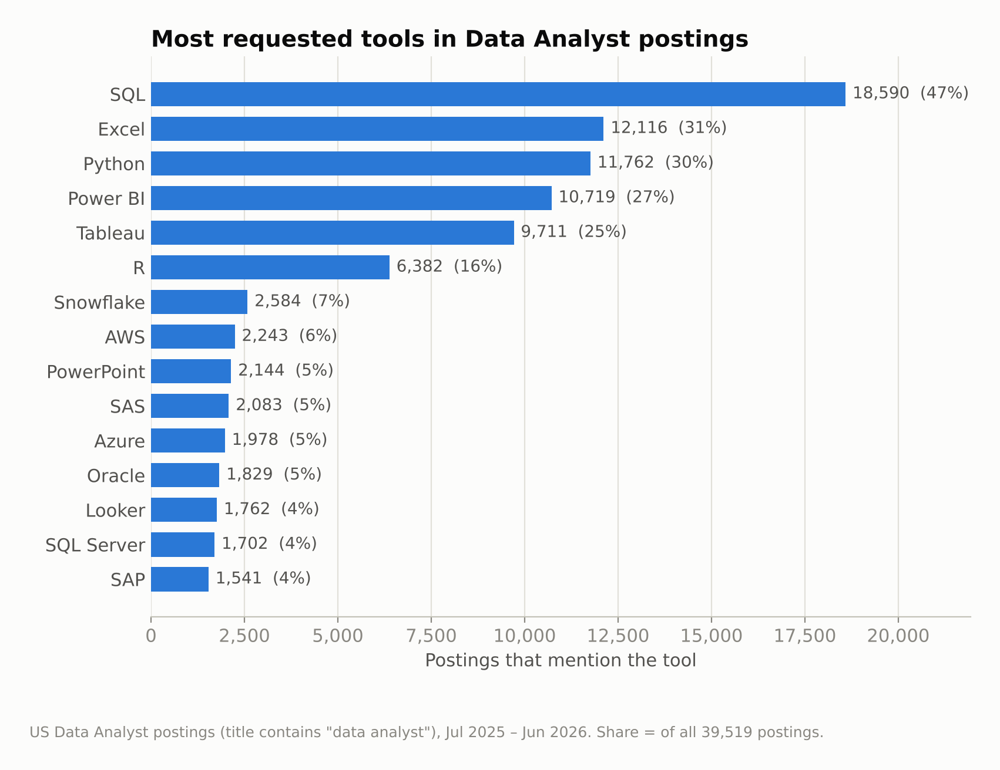
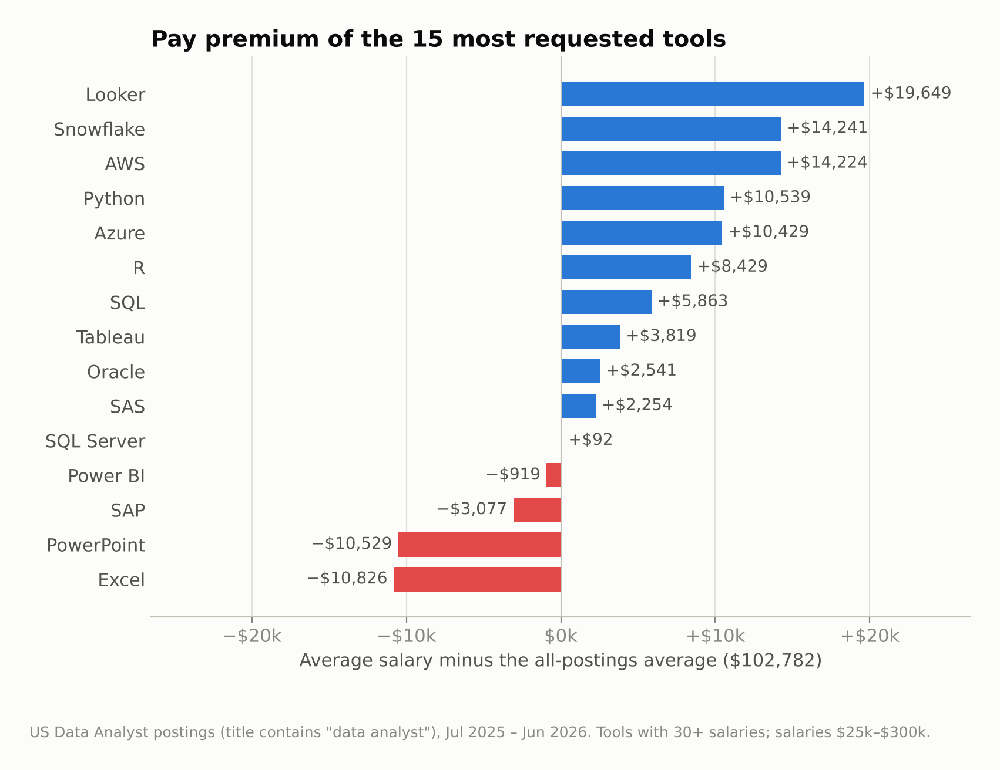
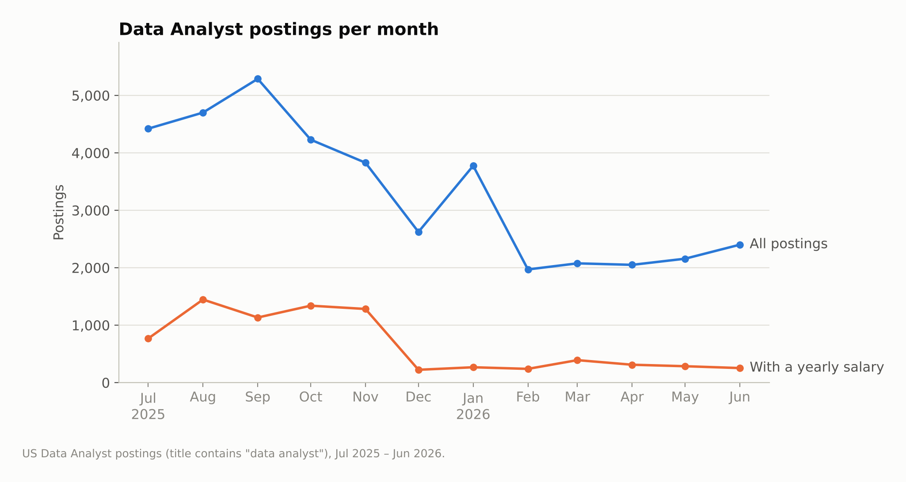
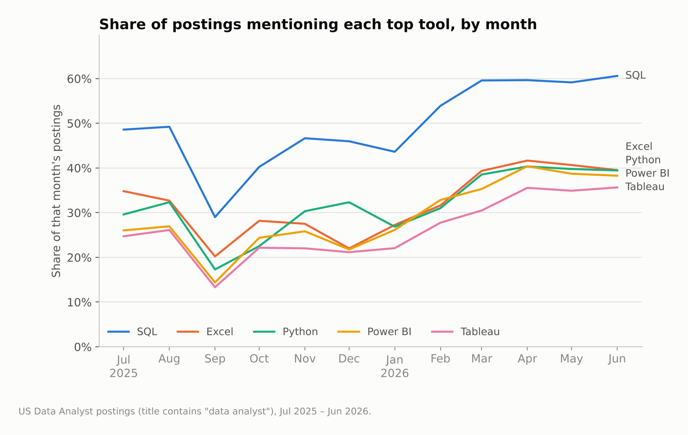

# Data-Analysis-Jobs

Which tools should an aspiring data analyst learn? This project answers that with a year of US job postings, looking at two things for each tool: **how often employers ask for it** and **what postings that ask for it pay**.

**Dashboards**
- [Data Analyst Skill Explorer](https://claude.ai/artifact/W4cww43zqM99szxejNtejn), the main dashboard.
- [Data Analyst Jobs EDA](https://claude.ai/artifact/KfqGK9sVaNTogVm4ftJ9hY), the exploratory analysis behind it.

Both are private until shared, so the links work only for people they've been shared with.

## Problem

Advice on what to learn for data analyst jobs is mostly opinion. Course catalogues list dozens of tools, and job postings mention hundreds. Someone starting out has limited time and needs to know which tools appear in the most postings and which come with better pay. Popular tools aren't always the best-paid ones, and well-paid tools aren't always in demand.

## Objective

Build a dashboard that lets a job seeker look up any technical tool and judge whether it's worth learning. For each tool it shows:

- **Popularity:** how many Data Analyst postings mention it.
- **Pay:** the average yearly salary of those postings.

The two are shown side by side, with no combined score, so the reader makes the call. Supporting views show the pay premium over the average posting, how many salaries each average rests on, and remote and hybrid work.

## Dataset

`data_jobs.duckdb` (about 47 MB) is on the `main` branch. It's a star schema of job postings from **July 1, 2025 to June 30, 2026**, covering 171 countries.

| Table | Rows | What it holds |
|---|---|---|
| `job_postings_fact` | 491,140 | One row per posting: title, role category (`job_title_short`), location, country, remote flag, posted date, salary period, yearly and hourly salary |
| `skills_job_dim` | 3,159,600 | Links postings to skills (`job_id`, `skill_id`) |
| `skills_dim` | 960 | Skill name and type (Programming Languages, Analytics, Infrastructure, Applications, and others) |
| `company_dim` | 65,970 | Company name |

The role categories are Data Engineer (298,184 postings), Data Analyst (123,655) and Data Scientist (69,301).

**Scope used for the analysis**

| Step | Postings | With a usable yearly salary |
|---|---|---|
| US postings in the source's Data Analyst category | 64,268 | 12,567 |
| US postings whose **title** contains "data analyst" (used) | 39,519 | 7,937 after outlier removal |

After cleaning, 313 technical tools remain, and 71 of them have at least 30 salaries behind their average. Full column lists are in [`.claude/skills/data-jobs-dataset/references/schema.md`](.claude/skills/data-jobs-dataset/references/schema.md).

## Key metrics

All metrics use US postings whose title contains "data analyst". Yearly salaries are kept between $25k and $300k, and only technical tools are counted. Full definitions are in [`references/metrics.md`](.claude/skills/data-jobs-dataset/references/metrics.md), and the SQL below comes from [`scripts/clean_views.sql`](.claude/skills/data-jobs-dataset/scripts/clean_views.sql).

| Metric | Definition | Example (all US) |
|---|---|---|
| Skill demand | Postings that mention the tool | SQL 18,590 (47% of postings) |
| Average salary | Mean yearly salary of postings mentioning the tool | Python $113,321 |
| Pay premium | Tool's average salary − average for all postings ($102,782) | Snowflake +$14,241 |
| Salary sample size | Salaries behind the average; shown only at 30 or more | SQL 3,545 |
| Remote % per employer | Remote postings ÷ the employer's postings, for employers with 20+ postings | Palo Alto Networks 26% |
| Postings per week | Postings ÷ 52.1 weeks | 758 |
| Hybrid share | Share of postings whose title says "hybrid" | 1.3% |

### Sample code

Open the database read-only and load the cleaned views:

```python
import duckdb

con = duckdb.connect("data_jobs.duckdb", read_only=True)
con.execute(open(".claude/skills/data-jobs-dataset/scripts/clean_views.sql").read())

print(con.sql("""
    select skill, postings, share_of_postings, avg_salary, pay_premium, salary_sample_size
    from skill_metrics
    where enough_salaries
    order by postings desc
    limit 10
"""))
```

**Scope: postings in the analysis**

```sql
select j.*,
       case when j.salary_year_avg between 25000 and 300000
            then j.salary_year_avg end as salary_clean      -- drop likely entry errors
from job_postings_fact j
where j.job_country = 'United States'                       -- one currency
  and j.job_title ilike '%data analyst%';                   -- Data Analyst titles only
```

**Skill demand, average salary and salary sample size**

```sql
select k.skill,
       count(*)              as postings,            -- skill demand
       round(avg(p.salary_clean)) as avg_salary,     -- average salary
       count(p.salary_clean) as salaries,            -- salary sample size
       count(p.salary_clean) >= 30 as enough_salaries
from da_skills k
join da_us p using (job_id)
group by k.skill
order by postings desc;
```

**Pay premium**

```sql
with base as (select avg(salary_clean) as all_avg from da_us)
select s.skill,
       s.avg_salary,
       round(s.avg_salary - b.all_avg) as pay_premium,
       round((s.avg_salary - b.all_avg) / b.all_avg, 4) as pay_premium_pct
from skill_stats s cross join base b
where s.enough_salaries
order by pay_premium desc;
```

**Remote % per company**

```sql
select c.name as company,
       count(*) as postings,
       sum(p.job_work_from_home::int) as remote_postings,
       round(avg(p.job_work_from_home::int), 4) as remote_pct
from da_us p
join company_dim c using (company_id)
group by c.name
having count(*) >= 20
order by remote_pct desc;
```

To rebuild the data files behind the dashboard:

```bash
python3 -I .claude/skills/data-jobs-dataset/scripts/build_dashboard.py data_jobs.duckdb out/
```

To redraw the charts in this README (needs `pip install duckdb matplotlib`):

```bash
python3 -I .claude/skills/data-jobs-dataset/scripts/make_readme_charts.py data_jobs.duckdb images/
```

## Findings

### Most requested tools



SQL is in almost half of all postings. Excel, Python, Power BI and Tableau each appear in a quarter to a third, and then demand drops sharply: no other tool is in more than 16%.

### Which tools pay more



Cloud and data-platform tools (Looker, Snowflake, AWS, Azure) carry the largest premiums among popular tools. Excel and PowerPoint sit about $10.5k below average, which suggests they're tied to more junior or administrative roles.

### Pay against popularity


There's no single best tool. The most requested tools sit near the average salary, while the highest-paid tools (Scala, dbt, Teradata, Spark) appear in only a few hundred to about a thousand postings. Python, SQL and R are the strongest mix of both: well to the right and above the average line.

### Trends over the year



Postings fell from 4,421 in July 2025 (peaking at 5,288 in September) to about 2,000–2,400 a month from February 2026. Postings that list a yearly salary fell even more sharply after November, from 1,282 to 223 a month. That drop is too abrupt to be the job market alone and probably reflects a change in how salaries were collected, so treat month-to-month pay comparisons with care.



All five top tools are mentioned in a larger share of postings by mid-2026. SQL rises from 49% to 61%, Python from 30% to 39% and Power BI from 26% to 38%. Their order stays the same. Because every tool rises together, part of this is likely a change in how skills were extracted rather than demand alone.

### Summary tables

**Most requested tools**

| Tool | Postings | Share | Average salary | Premium |
|---|---|---|---|---|
| SQL | 18,590 | 47% | $108,645 | +$5,863 |
| Excel | 12,116 | 31% | $91,956 | −$10,826 |
| Python | 11,762 | 30% | $113,321 | +$10,539 |
| Power BI | 10,719 | 27% | $101,863 | −$919 |
| Tableau | 9,711 | 25% | $106,601 | +$3,819 |
| R | 6,382 | 16% | $111,211 | +$8,429 |

**Highest pay premiums** (tools with 100 or more salaries)

| Tool | Postings | Average salary | Premium |
|---|---|---|---|
| dbt | 653 | $131,817 | +$29,035 |
| Spark | 1,164 | $130,351 | +$27,569 |
| Looker | 1,762 | $122,431 | +$19,649 |
| Redshift | 806 | $121,883 | +$19,101 |
| BigQuery | 1,053 | $120,466 | +$17,684 |
| Snowflake | 2,584 | $117,023 | +$14,241 |

## Limitations

- **Only US salaries are usable.** About 93% of salaries come from US postings; the UK, for example, has 9,165 postings but 16 salaries. Values outside the US also mix currencies, so the analysis is US only.
- **Most postings list no pay.** Only 20% of US postings give a yearly salary, so each average rests on a subset. Tools with fewer than 30 salaries are greyed out.
- **Salaries have entry errors.** Some yearly values reach $900k for roles like "PowerBI Developer". Values outside $25k–$300k are dropped, and hourly pay isn't converted to yearly.
- **"Data Analyst" is defined by the title.** The source's role category includes Business Analysts, BI Analysts and others. The title rule is stricter and keeps 39,519 of 64,268 postings. The dashboard can switch between the two.
- **Skills come from text matching.** Tools whose names are ordinary words were matched wrongly (Go, C, Ada, Narrative) and are removed. Also, 25% of postings link to no skill at all.
- **Premium shows correlation, not cause.** Senior roles ask for more tools and pay more. A premium means postings naming a tool pay more, not that learning it will raise your pay.
- **Remote and hybrid are undercounted.** Only fully remote postings are flagged, and 2,637 postings with "remote" in the title aren't. There's no hybrid field, so hybrid comes from job titles only.
- **Recruiters were removed by a hand-made list.** It was reviewed only for companies with 20 or more postings.
- **Collection changed during the year.** Monthly postings roughly halved from late 2025 to 2026, salaried postings fell from over 1,000 to about 250 a month after November, and every top tool's share rose at once. These shifts look like changes in how the data was gathered, so the trend charts show direction, not precise market change.
- **This is a snapshot.** The data covers one year and is a file, not a live source, so the dashboard changes only when the files are rebuilt.

## Recommendations

**For someone choosing what to learn**
1. **Start with SQL.** It's in 47% of postings and pays above the average posting. No other tool comes close on demand.
2. **Add Python next.** It's in 30% of postings with a +$10.5k premium, the best mix of demand and pay among the core tools.
3. **Pick one BI tool, Tableau or Power BI.** Each is in about a quarter of postings. Tableau postings pay slightly above average and Power BI slightly below.
4. **Keep Excel, but don't rely on it.** It's widely requested but comes with a −$10.8k premium, which suggests it's tied to entry-level roles.
5. **Then aim for a cloud data tool.** dbt, Spark, Looker, BigQuery, Snowflake and Databricks carry premiums of +$14k to +$29k, but appear in far fewer analyst postings. They're a step toward higher-paid, more technical roles.

**For the data and the project**
1. **Get description text, not just titles.** Hybrid work and many skills are mentioned in descriptions, which the data doesn't include.
2. **Convert hourly pay to yearly** (× 2,080 hours). That would add about 3,600 salaries, roughly 30% more salary data.
3. **Explain the mid-year shifts.** Find out why postings, salary listings and skill shares all changed around December 2025 before reading the trends as market changes.
4. **Add non-US data with currency conversion** once enough salaries exist, to make the location filter international.
5. **Look at seniority** (junior vs. senior titles) to separate a tool's pay effect from the seniority of the roles that ask for it.

## Repository layout

```
CLAUDE.md                                   Project notes and rules for Claude
README.md                                   This file
data_jobs.duckdb                            The database
images/                                     Charts used in this README
.claude/skills/data-jobs-dataset/
  SKILL.md                                  What's known about the data and the dashboard
  references/schema.md                      Table and column details
  references/metrics.md                     Metric definitions, formulas and caveats
  scripts/clean_views.sql                   Cleaned views and metric SQL
  scripts/build_dashboard.py                Builds the dashboard's data files
  scripts/build_eda.py                      Builds the EDA dashboard's data files
  scripts/make_readme_charts.py             Draws the charts in images/
  scripts/inspect.py                        Lists tables, schemas and sample rows
  scripts/get_db.sh                         Copies the database out of main
```
